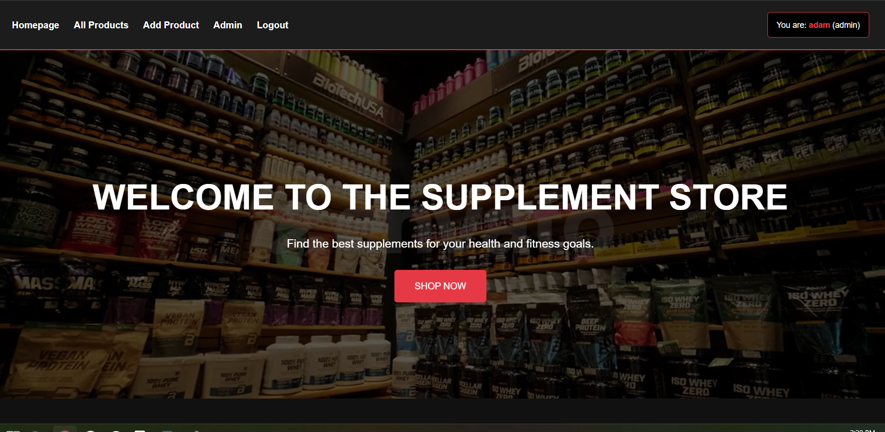
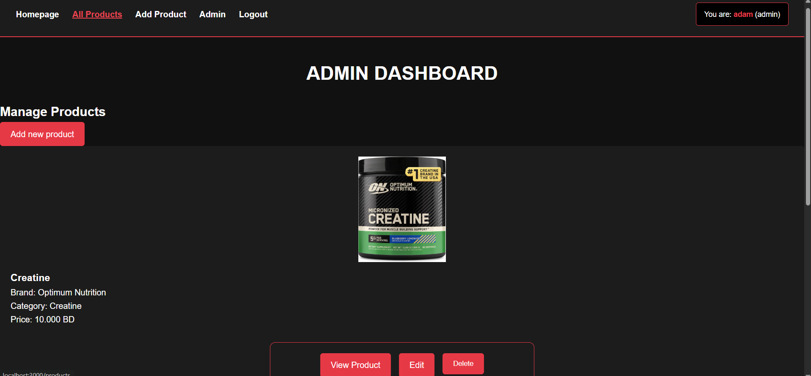
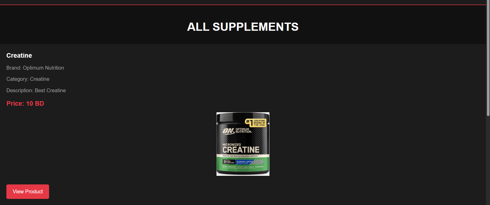

# Project Name

Gym Supplements Online Store

## Overview

This is a website that allows users to browse different gym supplements, view product information and leave reviews and ratings.

Users can create an account, sign in and view products and share their thoughts about the products. Admins have special priviliges that allow them to add, edit, and delete products from the store (CRUD).

## Screenshots
Home page 

--- 
Admin Dashboard

---

All Products Page

---

## Technologies Used

1. HTML
2. CSS
3. JavaScript
4. Node.js
5. Express.js
6. EJS
7. MongoDB
8. Mongoose
9. Git/Github

## User Stories
1. User should be allowed to browse through all store products
2. User should be able to view individual product details
3. A user is allowed to create an account
4. A registered user is allowed to signin/signout
5. A registered user is allowed to leave a review on a product
6. A registered user is allowed to leave a comment on a product
7. A user is allowed to view reviews left by other users
8. A registered user is allowed to delete their own reviews
9. An admin is allowed to add new products to the store
10. An admin is allowed to edit existing products
11. An admin is delete products from the store
12. An admin is allowed to access the admin dashboard

## Database Design'

3 MongoDB models: 

User – Stores username, password, and role (user or admin).

Product – Stores product name, brand, category, price, description, and image.

Review – Stores product ratings, comments, and the user who wrote the review.

Relationships:

One user can create multiple products.

One user can write multiple reviews.

One product can have multiple reviews.

--- 

## Routes

| Method | Route | Description |
|---------|-------|-------------|
| GET | / | Home page |
| GET | /auth/sign-up | Sign-up form |
| POST | /auth/sign-up | Register user |
| GET | /auth/sign-in | Sign-in form |
| POST | /auth/sign-in | Log in user |
| GET | /auth/sign-out | Log out user |
| GET | /products | List all products |
| GET | /products/new | New product form (Admin) |
| POST | /products | Create product (Admin) |
| GET | /products/:productId | View product |
| GET | /products/:productId/edit | Edit product form (Admin) |
| PUT | /products/:productId | Update product (Admin) |
| DELETE | /products/:productId | Delete product (Admin) |
| POST | /products/:productId/reviews | Create review |
| DELETE | /products/:productId/reviews/:reviewId | Delete own review |
| GET | /admin | Admin dashboard |

## Features

- User registration and authentication
- Browse all gym supplements
- View individual product details
- View product categories
- Create reviews and ratings 
- Delete own reviews
- Admin Dashboard
- Admin product management (CRUD)

## Future Enhancements
1. Add to cart feature
2. Discount codes feature
3. Add product inventory management
4. Add more gym related products instead of supplements such as equipment and accessories
5. Add online check out and payment system

## Credits
- Omar
- Zaid
- Github Resources